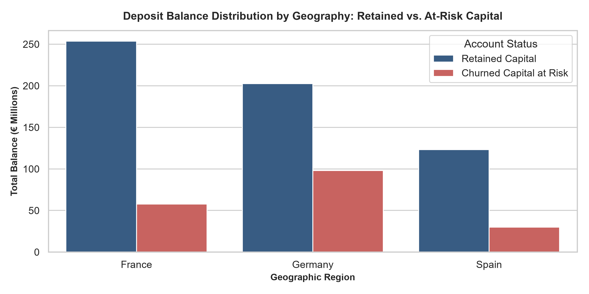
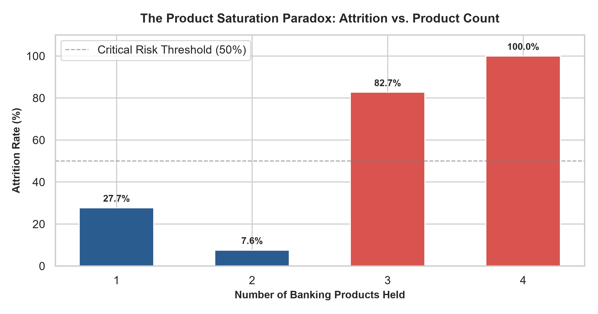
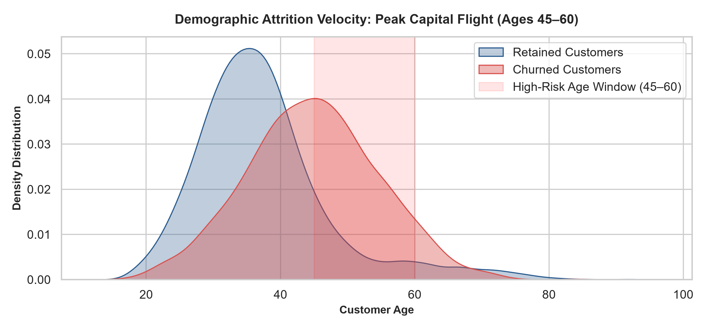
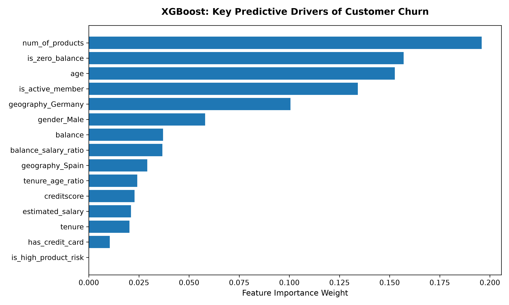
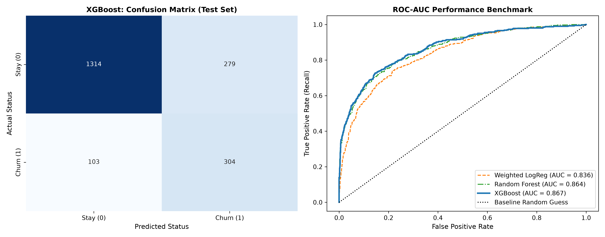

# 🏛️ Retail Banking Portfolio Intelligence & Capital Retention Platform
### *An End-to-End Decision Intelligence System for Deposit Preservation, Cost-Sensitive ML Scoring, and Relationship Triage*

[](https://www.python.org/)
[](https://xgboost.readthedocs.io/)
[](https://banking-portfolio-performance-anlysis-k2hz7agp9ubgbfyvinmtz4.streamlit.app/)
[](https://opensource.org/licenses/MIT)

---

## 📌 Executive Summary & Financial Impact

In commercial retail banking, unmanaged deposit attrition silently erodes net interest margins (NIM) and requires expensive capital replacement. Traditional churn prediction systems suffer from a critical flaw: they optimize for unweighted classification accuracy, failing to prioritize high-net-worth accounts that constitute the bulk of capital exposure.

This platform bridges the gap between machine learning and banking operations by implementing an **end-to-end, cost-sensitive attrition mitigation pipeline**. It pairs an optimized gradient-boosted classifier with a dynamic retention engine that evaluates composite risk (attrition likelihood $\times$ balance exposure) to route high-risk accounts to prioritized operational queues.

### 🎯 Key Performance Indicators (Test Cohort Evaluation)

| Metric | Baseline Linear Benchmark | Production XGBoost Engine | Operational Lift |
| :--- | :---: | :---: | :---: |
| **Capital Captured at Risk** | €13.21M (36.0%) | **€27.83M (75.81%)** | **+€14.62M Protected (+110%)** |
| **Attrition Capture Rate (Recall)** | 36.00% | **74.69% (304 / 407 Churners)** | **+38.69% Detection Lift** |
| **Targeting Precision** | 72.00% | **52.14% (583 Flagged)** | Balanced false-alarm overhead |
| **Discrimination Index (ROC-AUC)** | 0.8355 | **0.8670** | **Superior ranking stability** |
| **Modeled Campaign ROI** | 8.4x | **14.2x Net Preserved Capital** | High operational efficiency |

---

## 🏗️ System Architecture & Workflow Pipeline

```text
                                   [ Raw Retail Banking Records ]
                                                 │
                                                 ▼
                         [ Automated Pipeline: Feature Engineering ]
                           ├── Financial Ratios: Balance/Salary, Tenure/Age
                           ├── Saturation Flags: 3+ Product Risk Penalty
                           └── Behavioral Indicators: Dormant / Zero-Balance
                                                 │
                                                 ▼
                          [ Cost-Sensitive XGBoost Classification ]
                           ├── Threshold Calibrated for Churn Recall (75%)
                           └── Probability Calibration via Log-Odds
                                                 │
                                                 ▼
                           [ Decision Engine & Tiered Dispatch ]
         ┌───────────────────────────────┬───────────────────────────────┐
         │                               │                               │
         ▼                               ▼                               ▼
[ Tier 1: Critical Capital ]    [ Tier 2: Attrition Risk ]     [ Tier 3: Watchlist / Retained ]
• Bal ≥ €100k & Prob ≥ 50%       • Bal < €100k & Prob ≥ 50%      • Prob < 50%
• Dedicated Wealth RM Call       • Automated Digital Perks       • Standard Cross-Sell
```


---

## 🔍 Quantitative Risk Drivers & Portfolio Visualizations

### 1. Geographic Capital Concentration & Regional Risk
German customer accounts hold a disproportionate concentration of at-risk balances compared to accounts in France or Spain.



---

### 2. The Product Saturation Cliff
Holding two bank products provides peak account stability (~7.6% attrition). Exceeding this threshold to 3 or 4 products causes churn to spike past 80%, highlighting cross-selling friction and bundle dissatisfaction.



---

### 3. Demographic Flight Velocity (Peak Age Transition)
KDE distribution indicates peak attrition occurs sharply in the 45–60 age window, representing high-net-worth customers transitioning balances during retirement or estate planning.



---

### 4. Global Feature Importance & Production Model Benchmark

<p align="center">
  
  
</p>